# MyLibrary · домашнее задание 2
Веб-приложение для ведения личной библиотеки. За основу клиентской части взято первое домашнее задание(https://github.com/kl1dd/MyLibrary) и были добавлены REST API и маршрутизация.

## Возможности
1. Добавление новых книг с указанием автора, названия книги, жанра и статуса по прочтению.
2. Добавить заметку и поставить личную оценку книге.
3. Редактировать информацию о книге.
4. Удалить запись о книге.
5. Поиск книг по названию или автору.
6. Фильтрация по статусу прочтения и жанру.
7. Сохранение данных между сеансами работы в JSON-файле.
8. Просмотр отдельного раздела для просмотра книг, которым пользователь поставил оценку.
9. Просмотр отдельной страницы книги.
10. Отображение ошибок и состояний загрузки.
    
## Технологии
### Клиентская часть
- React
- TypeScript
- Vite
- Bootstrap
- Sass
- React Router
### Серверная часть
- Node.js
- Express.js
- TypeScript

## Инструкция по запуску
Требуется установленный Node.js 24.19.0 и npm.

Склонировать репозиторий, зайти в корневую папку проекта.
Далее для работы приложения надо запустить клиентскую и серверную часть(можно просто в двух терминалах).
### Запуск сервера
```
cd server
npm ci
npm run dev
```
Сервер будет доступен по адресу http://localhost:3000.
### Запуск клиента
```
cd client
npm ci
npm run dev
```
После выполнения команд Vite выведет в терминал адрес, по которому можно открыть проект.
(По умолчанию клиент будет доступен по адресу http://localhost:5173)

## Архитектура
Приложение разделено на три основные части:
- client/ - клиентская часть приложения
- server/ - серверная часть
- shared/ - общие типы
### Клиентская часть
Клиентская часть разделена на логические компоненты:
- App.tsx - общее состояние библиотеки, обработчики добавления, редактирования, удаления, поиск и фильтрация;
- DashboardPage.tsx - отображение статистики, списка книг и управление открытием формы добавления/редактирования книг;
- BookPage.tsx - отдельная страница одной книги;
- BookCard.tsx - карточка одной книги;
- BookForm.tsx - форма добавления/редактирования книги;
- Sidebar.tsx - переключение разделов(все книги и оценённые книги) приложения в сайдбаре;
- AppLayout.tsx, Header.tsx, Footer.tsx - общий каркас интерфейса;
- api/books.ts - функции для отправки HTTP-запросов на сервер.
### Серверная часть
Серверная часть разделена на логические компоненты:
- index.ts - настройка и запуск сервера Express.js;
- routes/booksRoutes.ts - обработчики HTTP-запросов, валидация данных;
- data/booksStorage.ts - функции чтения и записи данных в общий JSON-файл;
- data/books.json - общий файл, в котором хранятся книги.

## Основные решения
В отличие от первого домашнего задания, данные сохраняются не в localStorage браузера, а в JSON-файле на сервере. Все основные операции с книгами выполняются при помощи HTTP-запросов с использованием fetch и async/await.

Используемые хуки:
- useEffect - используется для загрузки данных с сервера;
- useState - хранит список книг, состояния запросов, значения полей формы;
- useParams - получает идентификатор книги из URL;
- useSearchParams - позволяет читать и изменять параметры поиска и фильтрации в URL;
- useNavigate - используется для навигации;
- useLocation - позволяет определить текущий раздел приложения.

В App.tsx хранятся два массива книг: bookList - полный список книг и visibleBooks - список книг, полученный от сервера с учётом поиска и фильтрации. При этом статистика всегда считается по всей библиотеке.

Для обработки конкурирующих запросов используется AbortController. При изменении параметров поиска и фильтрации предыдущий запрос отменяется, чтобы устаревший ответ не перезаписал актуальные данные.

Также из нового: на время выполнения запроса сохранения книги кнопка отправки формы блокируется, чтобы предотвратить повторную отправку.

## REST API
| Метод | Маршрут | Назначение |
|---|---|---|
| GET | /api/books | Получение списка книг |
| GET | /api/books/:id | Получение отдельной книги |
| POST | /api/books | Добавление книги |
| PATCH | /api/books/:id | Редактирование книги |
| DELETE | /api/books/:id | Удаление книги |
| GET | /api/health | Проверка работы сервера |

### Query-параметры
- search - поиск по названию или автору;
- status - фильтрация по статусу прочтения;
- genre - фильтрация по жанру;
- rated - получение оценённых книг (rated=true).

Пример запроса: /api/books?status=finished&rated=true

## Маршрутизация
- / - перенаправление на /books;
- /books - все книги;
- /rated - оценённые книги;
- /books/:id - отдельная страница книги.

После добавления и редактирования книги пользователь автоматически переходит на страницу этой книги, а после удаления - на страницу списка книг.

Пример адреса с параметрами фильтрации:
/books?search=Orwell&status=finished

## Демонстрационные данные
Данные для проверки приложения находятся в файле server/src/data/books.json.

## Демонстрация использования
1. Запускаем приложение. Фиксируем изначальное состояние
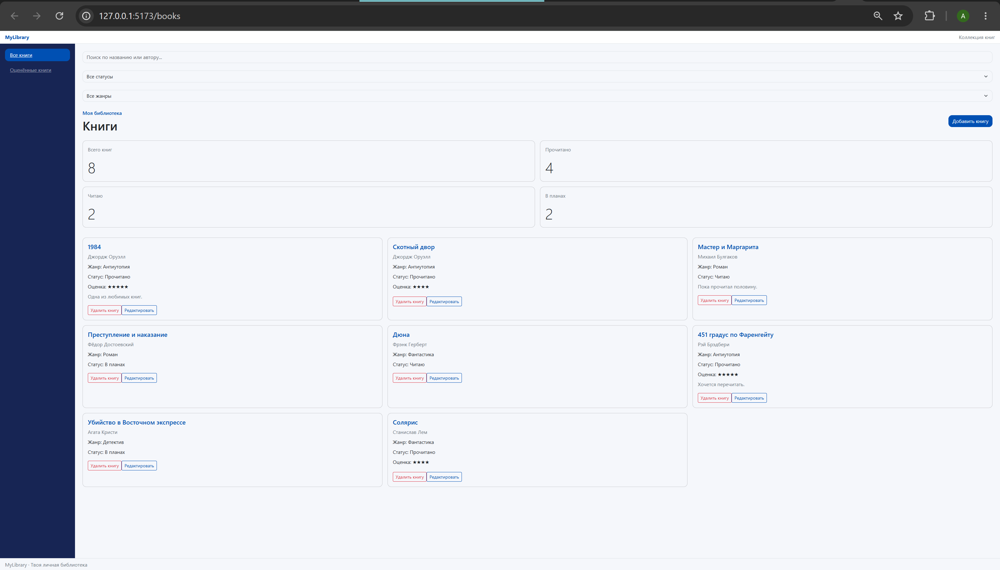
2. Пробуем добавить новую книгу, открывается формочка
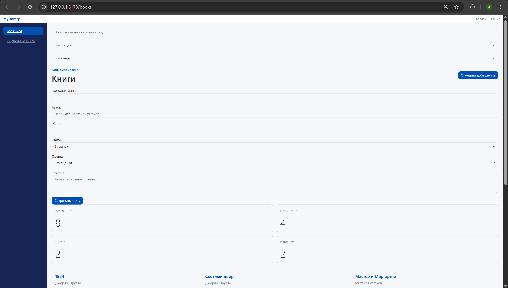
3. Заполняем форму и тыкаем добавить
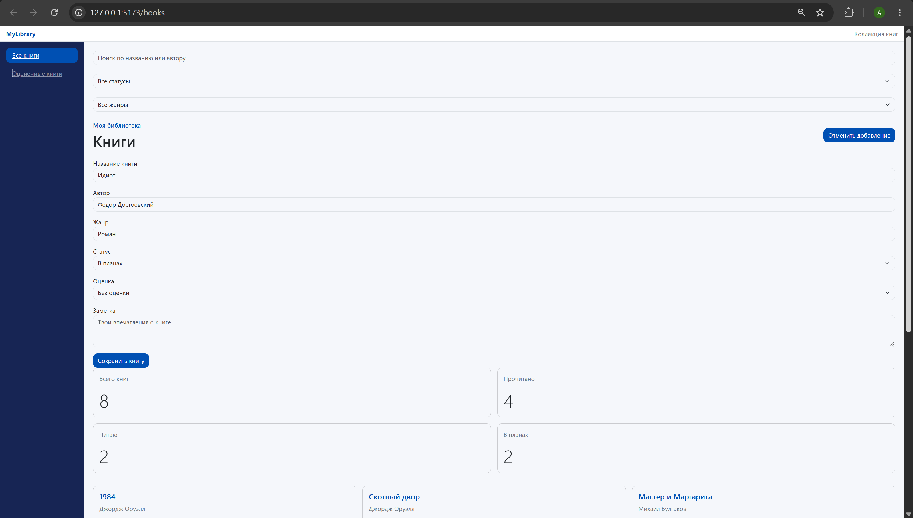
4. Сразу при добавлении открылась отдельная страница этой книги
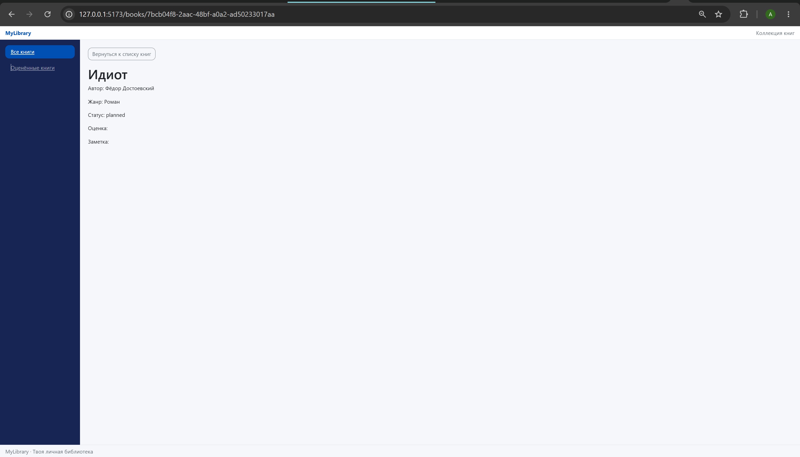
5. Пробуем редактировать книгу, ставим например 4 звезды
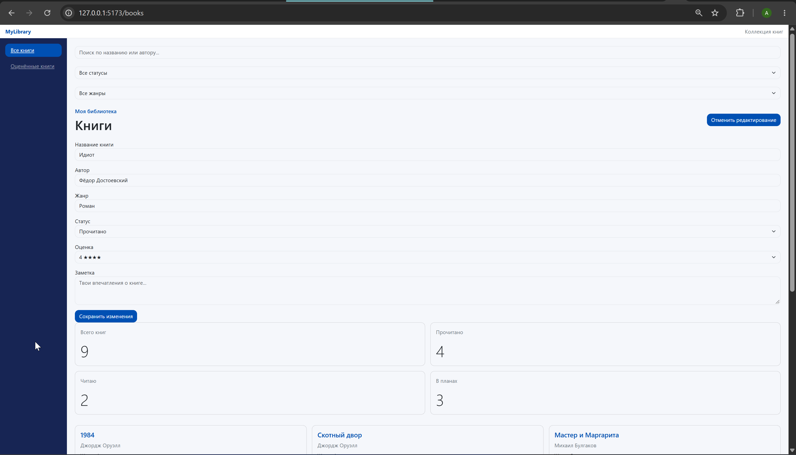
6. Нажимаем сохранить, вновь открывается страница этой книги и видим, что нужные поля поменялись

7. Тыкаем в сайдбаре оценённые книги и теперь отображаются только они, при этом адрес страницы поменялся
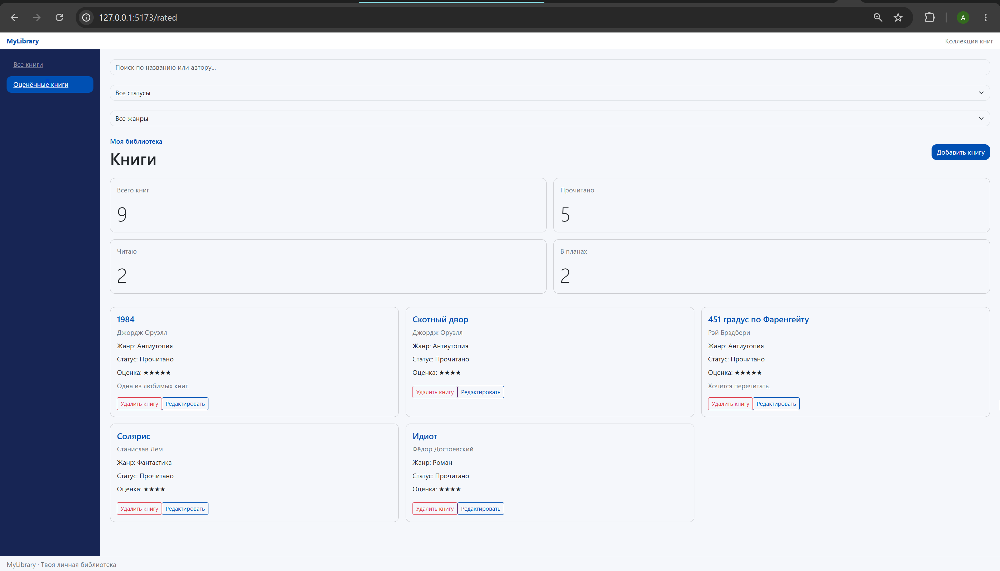
8. Во всех книгах пробуем найти книгу Пушкина и видим пустой результат
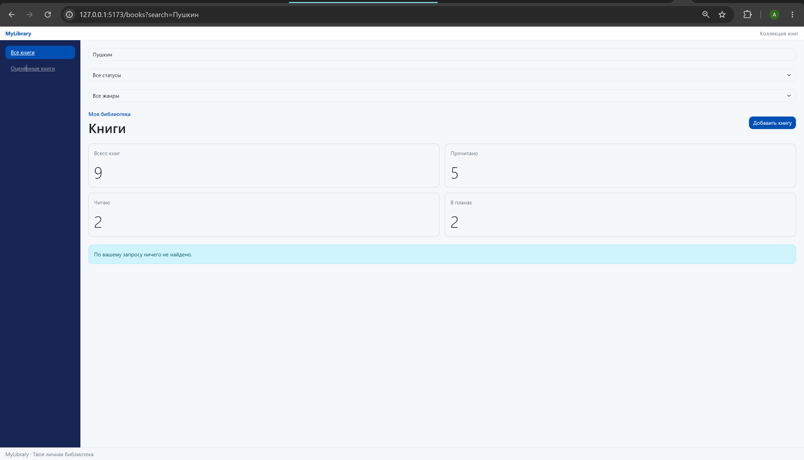
9. При этом книги Оруэлла находятся
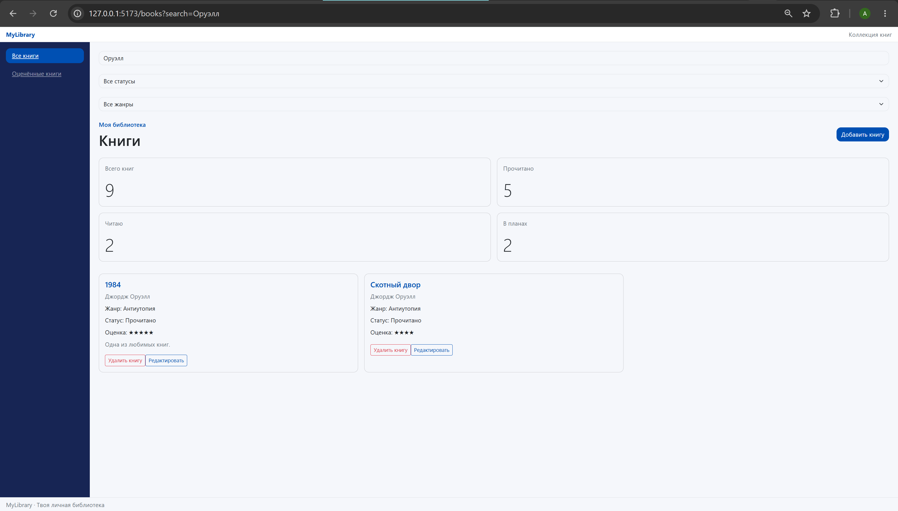
10. Пробуем найти по жанру и статусу прочтения
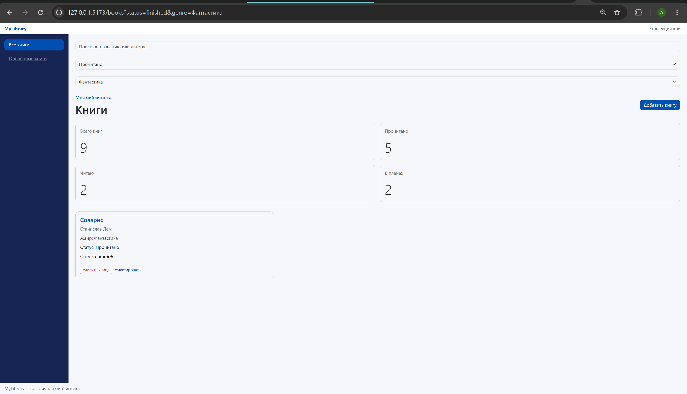
11. При нажатии F5 эти фильтры у нас не слетят

12. Если мы хотим из главной страницы открыть страницу книги, то нужно просто нажать по её названию
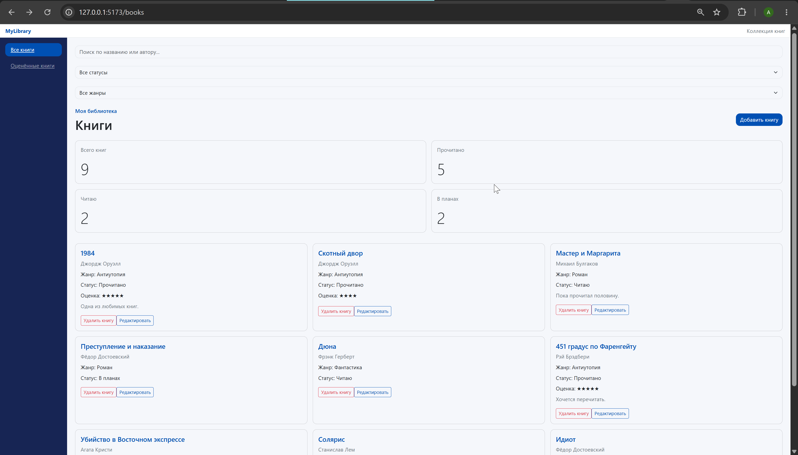
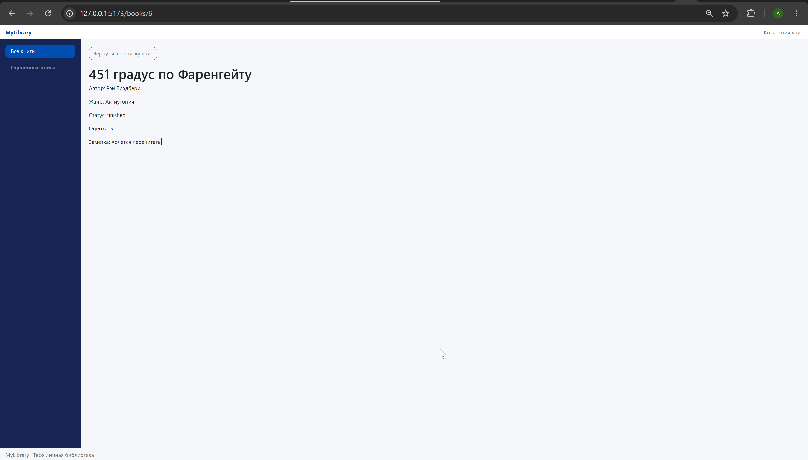
13. Нажимаем у "Идиота" удалить, книга из списка пропадает, статистика обновляется

14. Даже после перезапуска сервера все книги остались на месте
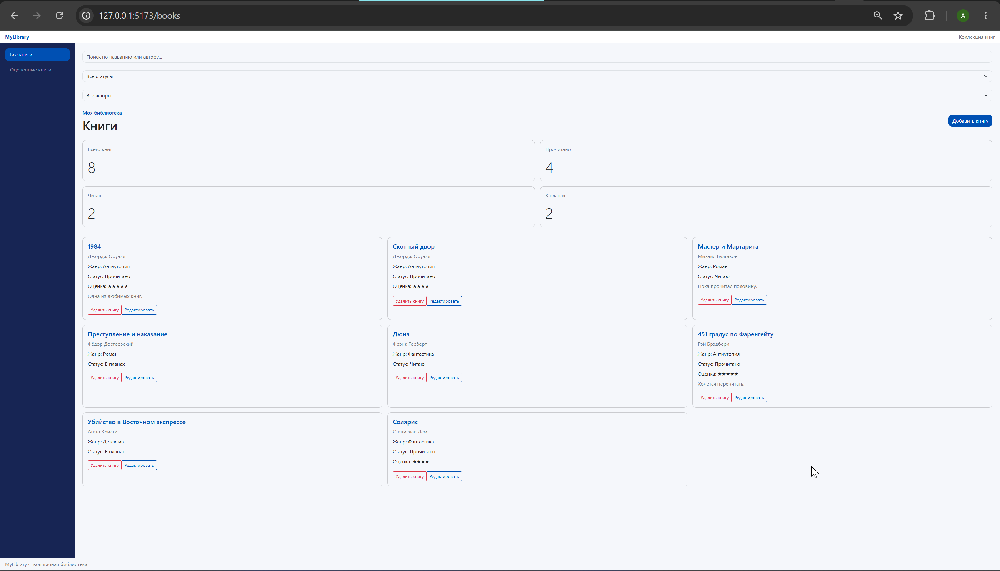
15. При попытке найти несуществующую книгу нам выдаст ошибку об этом
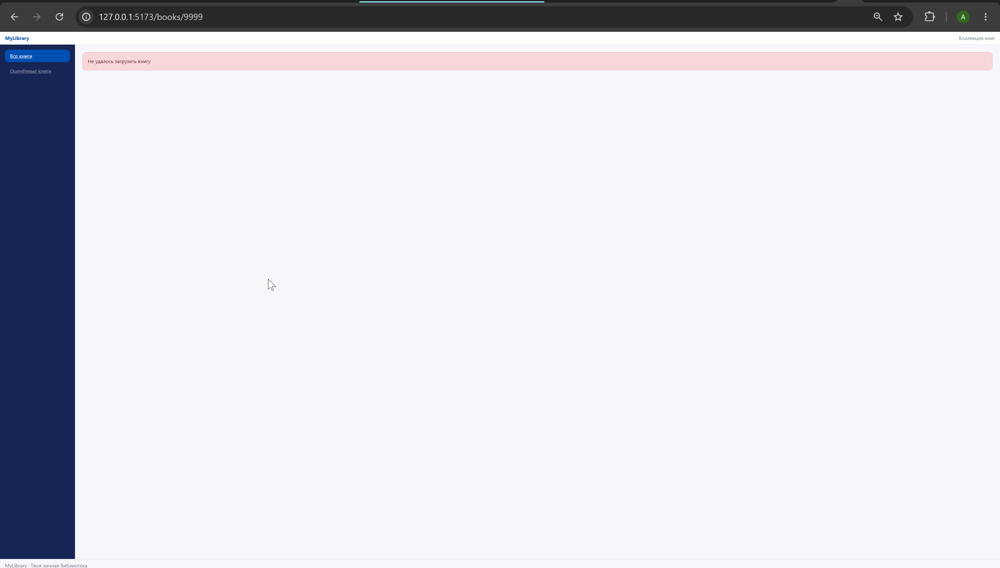
16. Сообщение при попытке перейти на несуществующую страницу
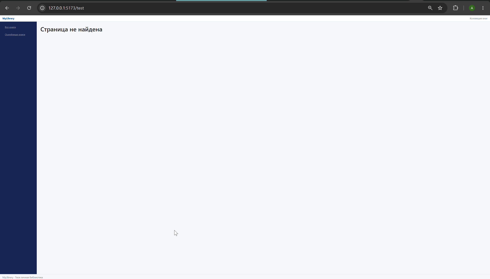
17. Книгу с незаполненой формой тоже создать не получится
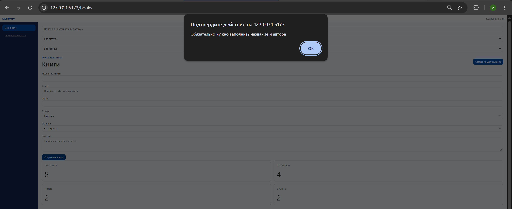